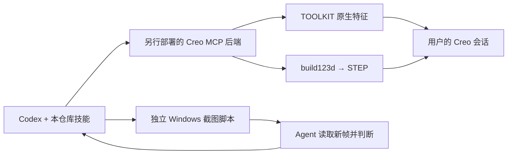

# Creo Codex Skills

[](https://github.com/jhyhd/creo-codex-skills/actions/workflows/validate.yml)
[](LICENSE)

面向 Windows 的中文 Codex 技能包：五个 Creo 自动化工作流，加上一个可独立运行的连续屏幕观察技能。涵盖原生特征、简单曲面、参数修改、排障、TOOLKIT 开发，以及执行结果的画面检查。性能有点差，复杂曲面基本不了实现

Chinese-first Codex skills: five Creo workflows plus an independent Windows screen-observation loop. The screen helper uses Python's standard library. Creo modeling requires a separate MCP backend and, for native features, a TOOLKIT plugin; neither backend is included.

**本仓库提供技能指令、示例、Windows 截图辅助脚本和 Creo 后端工具契约，不包含 Creo MCP 服务器或 TOOLKIT 插件实现。** 五个 Creo 技能需要合法安装的 Creo 和符合 [工具契约](docs/TOOL-CONTRACT.md) 的后端；`screen-observe-loop` 可独立截图，不依赖 Creo 或 MCP。截图内容仍需由 agent 读取和判断。

说明依据一套 Creo 11 / Windows 环境的本地实现整理。支持范围由后端版本决定，不代表 PTC 官方承诺，也不保证其他 Creo 版本可直接使用。

项目地址：[jhyhd/creo-codex-skills](https://github.com/jhyhd/creo-codex-skills)

## 六个技能

| 技能 | 适合的任务 | 关注点 |
|---|---|---|
| [creo-native-model](skills/creo-native-model/SKILL.md) | 板件、轴、法兰、支架等规则零件 | 后端支持的原生特征与 Creo 特征树 |
| [creo-surface-design](skills/creo-surface-design/SKILL.md) | 放样、扫掠、扭转和复杂外形 | build123d 几何、STEP 导入及实体有效性 |
| [creo-parametric-edit](skills/creo-parametric-edit/SKILL.md) | 修改已有零件的尺寸或参数 | 区分就地编辑、配方重建与模板重生成 |
| [creo-diagnose](skills/creo-diagnose/SKILL.md) | 会话、COM、插件和通信错误 | 保留现场，核实诊断与恢复操作的副作用 |
| [creo-toolkit-dev](skills/creo-toolkit-dev/SKILL.md) | 开发或修复原生特征插件 | 在另行取得的 TOOLKIT 项目中构建与验证 |
| [screen-observe-loop](skills/screen-observe-loop/SKILL.md) | 连续读取应用画面、检查操作结果与状态变化 | 有限时段截图，agent 读取新帧后决定下一步 |

每个技能都包含独立的 `SKILL.md`、UI 元数据和 MIT 许可证；较长的参数表与流程放在技能自身的 `references/` 中，可单独安装。

## 工作方式



原生通道可保留后端支持的 Creo 特征树；STEP 通道得到导入实体或曲面，外形修改主要回到代码或模板重生成。根据用户需要选择通道，不要求所有模型都使用原生参数化特征。

屏幕观察通道可用于 Creo 或其他桌面应用。`watch` 负责定时保存画面；agent 用 `view_image` 等图片读取工具查看新帧，按任务执行有限的“观察 → 判断 → 操作 → 再观察”循环。单独运行截图脚本不产生语义理解，也不会自动操作应用。

## 快速开始

### 1. 确认运行前提

阅读 [安装与前提](docs/SETUP.md)。使用屏幕观察需要 Windows、兼容的 Python 和可读取本地图片的 agent；使用 Creo 技能还需 Creo 会话与独立部署的匹配后端，原生建模另外需要 TOOLKIT 插件。

### 2. 安装所需技能

将本仓库下载或克隆到任意目录，在仓库根目录运行 PowerShell：

```powershell
git clone https://github.com/jhyhd/creo-codex-skills.git
Set-Location creo-codex-skills

# 先预览目标位置；有同名技能时脚本会拒绝覆盖。
.\scripts\install-skills.ps1 -WhatIf
.\scripts\install-skills.ps1
```

脚本默认安装到用户目录中的 `.agents/skills`，符合当前 [官方技能文档](https://learn.chatgpt.com/docs/build-skills) 的本地发现约定。旧版或定制客户端若使用其他位置，请显式指定目标，例如：

```powershell
.\scripts\install-skills.ps1 -Destination (Join-Path $env:USERPROFILE '.codex\skills')
```

脚本仅复制技能文件，不修改 Codex 权限、模型、MCP 配置、注册表或 Creo 启动配置。组织的 PowerShell 执行策略应按自己的环境处理。安装后按客户端要求重新加载技能或重启会话。

需要选择性安装时可使用 `-Name`，例如：

```powershell
.\scripts\install-skills.ps1 -Name creo-native-model,creo-diagnose
.\scripts\install-skills.ps1 -Name screen-observe-loop
```

### 3. 在 Codex 中调用

在有对应工具的 Codex 会话中显式调用，例如：

```text
用 $creo-native-model 创建 120×80×10 mm 的安装板，四角各一个直径8 mm通孔。
用 $creo-surface-design 做方圆过渡管，并说明产物是否有原生特征树。
用 $creo-parametric-edit 先读取当前零件的尺寸，再修改指定宽度。
用 $creo-diagnose 检查连接问题，先确认诊断工具是否有结束进程的副作用。
用 $creo-toolkit-dev 检查现有插件的特征实现，并给出验证步骤。
用 $screen-observe-loop 在接下来30秒读取当前应用画面，每次操作后查看新帧，确认结果后停止。
```

后端不可用时，技能应明确报告缺失依赖；不要用“代码已生成”代替“Creo 中已显示并保存”。生成的 CAD 仍需按用途验证。

### 独立运行截图辅助脚本

在仓库根目录使用临时输出目录，先截一帧，或在限定时间内连续截图：

```powershell
$frames = Join-Path $env:TEMP 'screen-observe-loop'
python skills/screen-observe-loop/scripts/observe_screen.py capture --output-dir $frames
python skills/screen-observe-loop/scripts/observe_screen.py watch --output-dir $frames --interval 2 --duration 30
```

要形成观察闭环，agent 仍需读取新保存的帧并核对结果。运行时截图应保存在临时目录，不加入 Git 或发布包。

## 能力边界

- 支持范围以部署的后端为准。参考实现中的 `draft`、`mirror` 尚未实现，不能因动作名称存在就报告支持。
- 同名重生成可能删除旧 `.prt.N` 文件；就地改尺寸和整件重建应明确区分。操作前核对 [工具契约中的文件副作用](docs/TOOL-CONTRACT.md)。
- 曲面或 STEP 导入成功后，仍需检查有效性、尺寸、实体数、开口和壁厚；工具返回 `shown` 也不证明实际窗口已完整显示模型。
- ID 概念几何与可行走、可制造、可量产设计的验收范围不同。运动、强度和工艺验证需另行完成。
- 连续截图仅提供画面证据，不会自动识别内容或验证 CAD 几何。观察应有时限、轮次和停止条件；遇到用户停止、目标达成或重复无进展时结束循环。

完整说明见 [能力与限制](docs/CAPABILITIES.md)。

## 文档导航

| 要做什么 | 阅读位置 |
|---|---|
| 准备环境与安装技能 | [SETUP](docs/SETUP.md) |
| 核对 19 个参考工具及文件副作用 | [TOOL-CONTRACT](docs/TOOL-CONTRACT.md) |
| 判断支持范围与交付形式 | [CAPABILITIES](docs/CAPABILITIES.md) |
| 排查会话、COM 或插件错误 | [TROUBLESHOOTING](docs/TROUBLESHOOTING.md) |
| 开发 TOOLKIT 原生特征 | [DEVELOPMENT](docs/DEVELOPMENT.md) |
| 连续观察桌面画面并回读结果 | [screen-observe-loop](skills/screen-observe-loop/SKILL.md) |
| 配置工作区指令 | [AGENTS 示例](examples/AGENTS.example.md) |
| 查看工具请求格式 | [原生板件](examples/native-plate.json) · [曲面过渡管](examples/surface-duct.json) |
| 了解发布范围与外部来源 | [第三方说明](THIRD_PARTY_NOTICES.md) |
| 贡献或发布此技能包 | [贡献指南](CONTRIBUTING.md) · [GitHub 发布说明](docs/PUBLISH.md) |

## 目录

```text
skills/       六个可独立安装的技能、内部参考及截图辅助脚本
docs/         安装、能力、工具契约、排障与开发说明
examples/     工作区指令和工具请求示例
scripts/      技能安装器与离线包检查
.github/      GitHub Actions 包检查工作流
```

截图等运行时产物不属于仓库内容，输出目录应放在仓库之外。

## 验证

```powershell
python scripts/check_package.py
```

该检查验证包结构、技能元数据、相对链接和发布文件范围，不会连接 Creo。离线检查通过不表示后端集成已通过；实际集成需在独立的测试会话中验证创建、再生、几何、保存和显示。

## 许可证

本仓库原创及整理后的技能、说明和辅助脚本采用 [MIT License](LICENSE)。PTC 软件、SDK、后端实现和外部参考资料不包含在此授权中，见 [第三方说明](THIRD_PARTY_NOTICES.md)。

本项目为独立社区资料，与 PTC、OpenAI 无隶属或认可关系。
